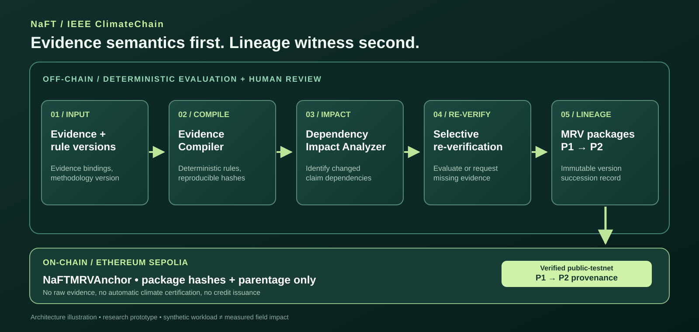

# NaFT — Version-Aware Climate MRV

> Carbon markets need evidence that survives methodology change.

NaFT ("Naft") is a research-stage **MRV evidence compiler and selective re-verification engine**. When a methodology, parameter, or evidence requirement changes, NaFT traces the affected dependencies, identifies which historical climate claims need another review, and preserves an auditable predecessor–successor evidence history.

**IEEE ClimateChain 2026 · Carbon Markets & Emissions Transparency**  
**Built by:** [Takzin1](https://github.com/Takzin1) · Independent research and development project

[**▶ Watch the 3:31 English demo**](https://youtu.be/VqxtWtyEDlM) · [**↗ Try the live browser demo**](https://takzin1.github.io/NaFT-IEEE_Climate_Hackathon_Edition/#/climatechain) · [**◎ Inspect Sepolia evidence**](https://sepolia.etherscan.io/address/0x1B7a3d1217Ffe5Ddd7d80E9734CeB6E32d4293B0) · [**✓ See GitHub Actions**](https://github.com/Takzin1/NaFT-IEEE_Climate_Hackathon_Edition/actions)

No sign-in, wallet, or installation is required to explore the public demo. The browser demo **does not** submit blockchain transactions.

## The problem in one minute

Carbon MRV (measurement, reporting and verification) is not static. Requirements, calculation parameters and source evidence change. An operator then needs to answer:

1. Which earlier claims depend on the changed requirement?
2. Which claims are unaffected, and which require new evidence?
3. Why did a claim's status change?
4. Can an independent reviewer reproduce the decision and inspect its history?

**NaFT's answer:** compile evidence-to-rule dependencies off-chain; conservatively re-evaluate affected claims; preserve immutable predecessor/successor package lineage; and publish minimal cryptographic lineage witnesses on a public testnet. **Blockchain is a provenance witness, not an environmental truth oracle.**

## Try it: one rule update, 100 claims

[Open the ClimateChain demo](https://takzin1.github.io/NaFT-IEEE_Climate_Hackathon_Edition/#/climatechain) and select **Run 100-claim methodology update**.

| Synthetic scenario result | Claims |
| :-- | --: |
| Candidate climate claims | 100 |
| Require re-verification | 30 |
| Unaffected | 70 |
| Automatically re-evaluated within the impacted group | 15 |
| Blocked until new evidence is supplied | 15 |

A synthetic transition `NAFT-SYNTHETIC@1 → @2` changes requirements for a selected subset of claims. Expand **Why this claim changed** for `CLIMATE-086` to inspect the dependency explanation and package lineage. Then open **Prepare blockchain anchor plan** to inspect the exact proposed arguments alongside previously recorded public testnet transactions.

> **Interpretation guardrail:** These are deliberately constructed **synthetic claims**, not 100 real farms. The 30/70 distribution is a fixture result, **not a measured 70% time/cost saving**. Nothing here establishes measured emissions reductions or issued carbon credits.

[Watch the guided English demo on YouTube](https://youtu.be/VqxtWtyEDlM) · [Read the four-click judge walkthrough](docs/ieee-submission-pack.md)

## What is different about NaFT?

| Design choice | Why it matters |
| :-- | :-- |
| **Version-aware evidence compilation** | A claim is tied to the methodology and evidence used to evaluate it. |
| **Five dependency-change classes** | Methodology, evidence, parameter, field, and activity changes can trigger targeted review. |
| **Selective, fail-closed re-verification** | Missing or incompatible evidence blocks a new result instead of silently approving it. |
| **Independent recomputation** | A separately implemented full-recomputation oracle checks the impact analyzer in a bounded synthetic state space. |
| **Append-only package succession** | The old package is retained; a successor explicitly points to its predecessor. |
| **Minimal public-chain witness** | Sepolia records package hashes and parentage; raw evidence and scientific judgment remain off-chain. |



The system is designed for **project aggregators** and **MRV/verification operators** investigating changed claims. A registry or program could examine package history, but **no production registry integration, verifier acceptance, or certification is claimed**.

## Engineering evidence — what was actually tested

| Test or evidence | Reproducible result | Boundary |
| :-- | :-- | :-- |
| Synthetic 100-claim update | 30 impacted / 70 unaffected; 15 auto / 15 need evidence | Illustrative fixture, not field impact |
| Independent impact analysis | 614 deterministic adversarial changes across 5 classes: TP 429, TN 78, FP 107, FN 0 | Zero false negatives applies **only** to the tested synthetic state space |
| Core regression, browser, contract and security checks | [Main CI succeeded on 2026-10-21 at `56dd44f`](https://github.com/Takzin1/NaFT-IEEE_Climate_Hackathon_Edition/actions/runs/39552343285) | Historical green run, not an assertion that every future commit passes |
| Public Sepolia source-bound read-only verification | [Independent verifier succeeded on the same 2026-10-21 head](https://github.com/Takzin1/NaFT-IEEE_Climate_Hackathon_Edition/actions/runs/39552343213) | Verifies hash lineage and contract behavior, not climate truth |
| Published research-data arithmetic | Source-bound reference or published-aggregate replays with independent numerical oracles | Publication/source identity and scientific acceptance have separate gates |

This approach intentionally tolerates conservative additional review rather than claiming universal zero-error operation. See [impact soundness](docs/impact-soundness.md), [portable audit receipt and tamper challenge](docs/ieee-audit-receipt.md), and [independent repository verification history](docs/INDEPENDENT_VERIFICATION_REPORT.md). **The historical verification report includes an earlier private-candidate stage; it must not be read as today's publication status.**

## Ethereum Sepolia — public, verifiable, limited in scope

- **Network:** Ethereum Sepolia (chain ID `11155111`)
- **Contract:** [NaFTMRVAnchor — public contract](https://sepolia.etherscan.io/address/0x1B7a3d1217Ffe5Ddd7d80E9734CeB6E32d4293B0)
- **Deployment:** [transaction](https://sepolia.etherscan.io/tx/0x7695a040d1639ebf5b2fcc96ec6c879e5ccc28c46d95d9371f906769b8a12188)
- **Predecessor P1:** [transaction](https://sepolia.etherscan.io/tx/0x85c25a7ee239d7178c7266bf50e22c41bd30debfc7e37e579d437f1730d8fc34)
- **Successor P2:** [transaction](https://sepolia.etherscan.io/tx/0xb5aef9810d6eb9c7516c0c9c6aadcf05fe952fb9170338fb915a5aa204579ac5)
- **Deployment-source snapshot:** [source commit `fb9016c6`](https://github.com/Takzin1/NaFT/commit/fb9016c6c3041ec0e77098e631d62138fbae582e)

The public testnet records that P2 references P1. The **Prepare blockchain anchor plan** button is local computation; it does **not** broadcast a new transaction. The independent verifier reconstructs bytecode and expected plan from the recorded source and checks calldata, events, writer identity, and final claim head via read-only RPC.

**No token minting, carbon-credit issuance, registry approval, or proof of environmental truth occurs on-chain.** See [the testnet runbook](docs/testnet-anchor-runbook.md) and [testnet record](src/climatechain-testnet-record.js).

## Reproduce the claims

Clone this independent IEEE repository, then run the existing test entry points:

```bash
git clone https://github.com/Takzin1/NaFT-IEEE_Climate_Hackathon_Edition.git
cd NaFT-IEEE_Climate_Hackathon_Edition

# Full local regression suite (see environment/tool requirements in docs)
bash tests/run.sh

# Read-only Ethereum Sepolia source-bound verification; no signing key or gas
bash scripts/verify-live-sepolia.sh

# Selected research reference tests
node tests/japan-ieee-oracle-parity.test.mjs
node tests/nid-2026-published-subset.test.mjs
node tests/ieee-gs-worksheet-replay.test.mjs
```

The Sepolia script needs a reachable public RPC endpoint. The complete regression suite may require the documented local runtime/toolchain; consult the [testing guide](docs/test-report.md), [capture runbook](docs/automated-video-recording.md), and [submission freeze checklist](docs/submission-freeze.md).

The original IEEE work was migrated with **actual preserved Git ancestry**, not represented as a fresh untraceable rewrite: [source branch](https://github.com/Takzin1/NaFT/tree/hackathon/ieee-climatechain-2026), [source snapshot](https://github.com/Takzin1/NaFT/commit/c87b534877293133ad92ac398b95936608bfd91b), and [migration verification](docs/DESTINATION_MIGRATION_STATUS.md).

## Research basis and evidence hierarchy

NaFT separates **(a) published scientific evidence**, **(b) experimental numerical replay**, **(c) official methodology references**, and **(d) certified project claims**. These levels are **not interchangeable**.

| Source | How this repository uses it | Important limit |
| :-- | :-- | :-- |
| [IPCC 2019 Refinement, Vol. 4, Ch. 5 — Cropland](https://www.ipcc-tfi.iges.or.jp/public/2019rf/pdf/4_Volume4/19R_V4_Ch05_Cropland.pdf) | Reference guidance and illustrative rice-method calculation context | Not authorization for a specific Japanese crediting method |
| [Japan NID 2026 (NIES/GIO)](https://www.nies.go.jp/gio/archive/nir/qu9bd60000050ys2-att/NID-JPN-2026-v3.0_J_gioweb.pdf) | Selected official *published inventory reference* factors; 18 transcribed Tohoku/2024 cells | Original publisher PDF bytes not fully pinned; no automatic AG-005 approval |
| [Itoh et al. (2011)](https://doi.org/10.1016/j.agee.2011.03.019) | Reported nine-site, two-year paddy research aggregates as scientific context | Not raw plot-level observations or a national credit factor |
| [Yagi et al. (1996)](https://doi.org/10.1029/96GB00517) | Replay of selected published methane treatment aggregates | Published values, not original raw flux series |
| [Nishimura et al. (2004)](https://doi.org/10.1029/2003GB002207) | Independent arithmetic check of published CH4/N2O-N aggregates and rounding | Not certification or field-level causal attribution |
| [JapanFlux2024 JP-Hrt dataset](https://doi.org/10.17592/001.2024121020) and [JapanFlux methodology paper](https://doi.org/10.5194/essd-17-3807-2025) | Research-only native-data intake and provenance/QC conflict detection | Incomplete CH4 coverage, unresolved units/method descriptions; no annualization or certified reduction |
| [J-Credit official methodology catalog](https://japancredit.go.jp/about/methodology/) | Authority to check AG-005 version/applicability | Active AG-005 release and transition approvals remain gated |
| Gold Standard training worksheet; Verra VM0051 v1.1 references | Strictly separated training arithmetic and **reference-only** method routing | Not an accepted/implemented verification program or certified credit |

Further reading and source-lock details: [Japanese primary-evidence gate](docs/japan-2026-primary-evidence-onramp.md), [Yagi/Nishimura research replay](docs/ieee-japan-original-studies-migration-2026-10-19.md), [JapanFlux original-data conflict check](docs/japanflux-jp-hrt-v200-consistency-2026-10-19.md), [independent observation parity](docs/ieee-per-input-observation-parity-2026-10-19.md), [Gold Standard worksheet arithmetic](docs/ieee-gs-independent-workbook-replay-2026-10-19.md), and [Gold Standard/Verra method boundaries](docs/rice-methodology-formula-routing-2026-10-19.md).

A record hash proves byte consistency with a local artifact; **it does not independently authenticate the scientific publisher or legal applicability**. For these research pathways, unknown quality-control flags, missing observations, unsupported method versions, and other evidence gaps are not converted to credits or official totals.

## Project map

| Start here | Then go deeper |
| :-- | :-- |
| [Public demo](https://takzin1.github.io/NaFT-IEEE_Climate_Hackathon_Edition/#/climatechain) | [Demo script](docs/climatechain-video-script.md) · [Judge walkthrough](docs/ieee-submission-pack.md) |
| [Architecture](docs/assets/naft-climatechain-architecture.svg) | [Design documentation](docs/architecture.md) · [Data model](docs/data-model.md) |
| [Testing](https://github.com/Takzin1/NaFT-IEEE_Climate_Hackathon_Edition/actions) | [Independent test report](docs/INDEPENDENT_VERIFICATION_REPORT.md) · [Security checklist](docs/security-checklist.md) |
| [Scientific provenance](docs/japan-2026-primary-evidence-onramp.md) | [JapanFlux QC](docs/japanflux-jp-hrt-thesis-qc-2026-10-19.md) · [Asia research comparison](docs/asia-mrv-baseline-parity-2026-10-18.md) |
| [Submission resources](docs/ieee-submission-pack.md) | [Devpost copy](docs/devpost-submission-draft.md) · [Freeze protocol](docs/submission-freeze.md) |

## Known limitations and next research steps

- The headline 100-claim and 614-case results are **synthetic**, with intentionally bounded assumptions and no measured cost or time savings.
- Public Sepolia verifies **cryptographic provenance and predecessor/successor linkage**, not emissions data, methodologies, credit issuance, environmental impact, or auditor approval.
- Selected external studies are reproduced as **published aggregates or reference calculations**, not raw-data scientific replication. Some primary bytes, licenses, scientific QC and source metadata remain unresolved.
- No live production MRV operator, accrediting verifier, carbon registry, or J-Credit/Verra/Gold Standard program has certified NaFT's results.
- Next steps: independently authenticate primary source bytes and method versions; address missing data and QC discrepancies; evaluate reviewer workload against real practitioner workflows; strengthen security and tenant/evidence isolation before deployment.

See [known limitations](docs/known-limitations.md) and [roadmap](docs/roadmap.md). This open project is an **engineering prototype and research platform**, not professional verification or an issued-credit registry.

---

### At a glance

**Watch:** [English narrated IEEE demo](https://youtu.be/VqxtWtyEDlM) · **Try:** [Live application](https://takzin1.github.io/NaFT-IEEE_Climate_Hackathon_Edition/#/climatechain) · **Inspect:** [Verified Sepolia contract](https://sepolia.etherscan.io/address/0x1B7a3d1217Ffe5Ddd7d80E9734CeB6E32d4293B0) · **Reproduce:** [GitHub Actions](https://github.com/Takzin1/NaFT-IEEE_Climate_Hackathon_Edition/actions)

IEEE ClimateChain Global Hackathon 2026 submission materials. Public Devpost project status should be checked separately; a GitHub README is not a submission confirmation.
